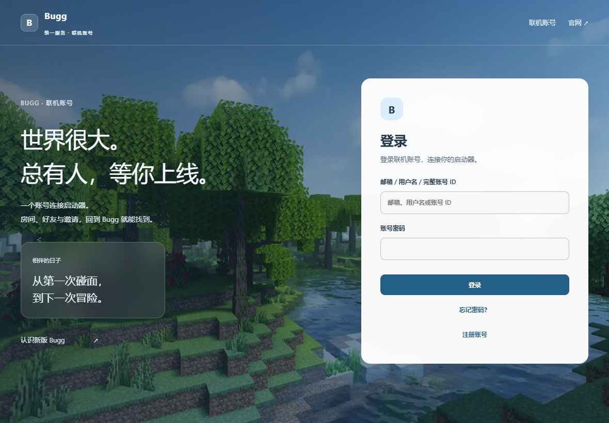
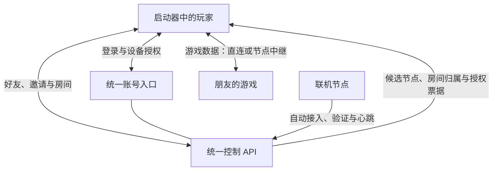

# Bugg 统一服务

**登录一次，找到朋友，连接你们的世界。**

账号与设备授权 · 好友邀请 · 房间目录 · 节点分配

[**登录与账号**](https://node.bugg.icu/login) · [**下载启动器**](https://download.bugg.icu/) · [**玩家教程**](https://bugg.icu/docs) · [**接入文档**](docs/08-构建运行与接口.md)

---

Bugg 统一服务把联机账号、设备授权、好友与房间信息放在同一个入口。你不用到每一台节点重新注册，也不必知道朋友分配到了哪台服务器：在启动器登录、邀请、加入，服务负责确认身份和房间归属。

它负责联机的协调，**游戏数据通过 P2P 或联机节点传输**，不会经过统一服务转发。房主仍在自己的电脑运行 Minecraft、保管世界存档。

## 对玩家有什么用

| 你要做的事 | 统一服务负责的部分 |
| --- | --- |
| 在启动器登录联机账号 | 浏览器登录、批准设备授权；节点不再单独提供登录入口。 |
| 换电脑或停止使用旧设备 | 查看与撤销授权设备，分别管理每台设备的访问。 |
| 约朋友一起玩 | 维护好友关系、邀请和在线状态，供启动器显示与操作。 |
| 找到朋友的房间 | 记录房间所属节点与加入策略，让加入请求跟随同一个房间。 |
| 创建新的房间 | 按服务端允许的地区、节点健康与容量产生候选，再预留容量。 |

好友、邀请和房间操作主要在 **启动器** 完成；网页用于登录、邮箱及设备等账号操作。需要联机教程可查看 [创建房间](https://bugg.icu/docs/help/create-room) 与 [加入房间](https://bugg.icu/docs/help/join-room)。

## 三步开始联机

1. 打开 Bugg 启动器的「联机」，使用默认服务；使用社区自建服务时，在启动器中选择对应入口。
2. 在浏览器登录并确认设备授权，返回启动器。
3. 添加好友、发送邀请，或创建与加入房间；随后按提示准备游戏环境。

需要找回账号时，使用登录页提供的邮箱找回流程。个人账号页功能取决于服务部署版本与邮箱配置；设备授权、账号密码与 Minecraft 游戏账号是不同的凭据，请勿互相混用。

## 统一服务、节点、桥，各做什么

统一服务与 [联机节点、桥和 SDK](https://github.com/vdjango/minecraft-tunnel-native) 独立维护，也可部署在同一台服务器上。分开部署时保持各自配置和权限，不向工作节点分发管理员凭据、数据库密码或中心签名私钥。

## 为什么这样分配节点

- **地区只是起点**：先按服务策略、健康与容量筛选，再结合客户端探测信息选择候选，避免所有玩家都涌向同一台机器。
- **加入朋友要跟随房间**：已有房间有明确归属，访客不会因为身处不同地区被分到另一个房间节点。
- **预留容量有期限**：预留、确认和释放分别记录，避免把一次候选查询当成已经占到位置。
- **失联不冒充离线**：健康和在线信息有有效期，过期状态按未知处理，不把网络波动当作玩家主动退出。

控制服务短暂不可用时，已建立的数据连接由原有桥与节点继续处理；新登录、邀请和分配仍依赖控制服务。当前架构不承诺中心无单点，也不承诺游戏 TCP 连接无缝迁移。

## 自建服务与接入社区节点

支持部署自己的统一服务，节点通过配置指定所信任的服务地址。官方与自建服务使用相同接入协议，不要求修改桥或节点源码。

1. 按 [构建与运行指南](docs/08-构建运行与接口.md) 准备服务、PostgreSQL、HTTPS 与私有配置。
2. 配置公开入口、账号与邮箱能力，以及允许使用的节点池、地区和容量策略。
3. 为节点提供注册所需的接入信息，节点生成自己的密钥，完成注册、可达性验证与心跳。
4. 在客户端选择你的统一服务；联机账号与数据归属该服务的信任域。

长期入网凭证默认不设到期时间，可撤销和轮换，**只允许注册节点**。注册成功不等于自动获得管理员权限，也不等于可以跳过可达性与分配资格检查。

当前源码为 C++20 服务，账号后端与控制 API 使用同一个原生服务进程；网页资产沿用联机仓库的唯一前端实现，不在这里复制一套。节点运行控制的原生化状态应以节点仓库为准。

## 性能与可靠性

服务使用 Boost.Asio/Beast、OpenSSL、PostgreSQL 和 simdjson，采用有界工作队列与连接预算。JSON 与密码库按运行环境选择实现，保留通用 CPU 路径，不要求全局 AVX2 或 AVX-512。

这些优化主要降低协调请求的处理与排队成本，**不能直接换算成游戏 FPS 或网络延迟的提升**。具体机器、实测范围与尚未验证的平台见 [验收与性能报告](docs/09-开发验收与性能报告.md)。CI 徽章反映远端实际结果，不代表本地未提交代码或线上服务的健康状态。

## 文档与参与

| 想了解什么 | 文档 |
| --- | --- |
| 项目范围与全部文档 | [规划总览](docs/00-规划总览.md) |
| 部署、配置与实际 API | [构建运行与接口](docs/08-构建运行与接口.md) · [配置示例](config.example.json) |
| 节点如何接入、账号如何授权 | [接入账号与消息协议](docs/02-接入账号与消息协议.md) |
| 地区与容量怎么分配 | [地区分配与容量调度](docs/03-地区分配与容量调度.md) |
| 数据一致性与资源释放 | [生命周期与一致性](docs/07-生命周期与一致性.md) |
| 原生账号迁移与数据保留 | [原生账号与迁移](docs/11-原生账号与迁移.md) |

欢迎通过启动器内的「问题反馈」提交复现步骤。涉及协议或代码的改动，先阅读 [协作约束](AGENTS.md) 与 [复用清单](docs/06-复用与方法DOM清单.md)，避免在节点、桥和客户端各维护一份账号或分配规则。

## 许可说明

本仓库目前未附项目 LICENSE，不能据仓库公开可见推定获得开源使用授权。发布、再分发或贡献代码前，应先明确项目许可；第三方依赖许可见 [THIRD_PARTY_NOTICES.md](THIRD_PARTY_NOTICES.md)。

Bugg 与 Mojang、Microsoft 无隶属关系。Minecraft 是 Mojang Studios 的商标。
