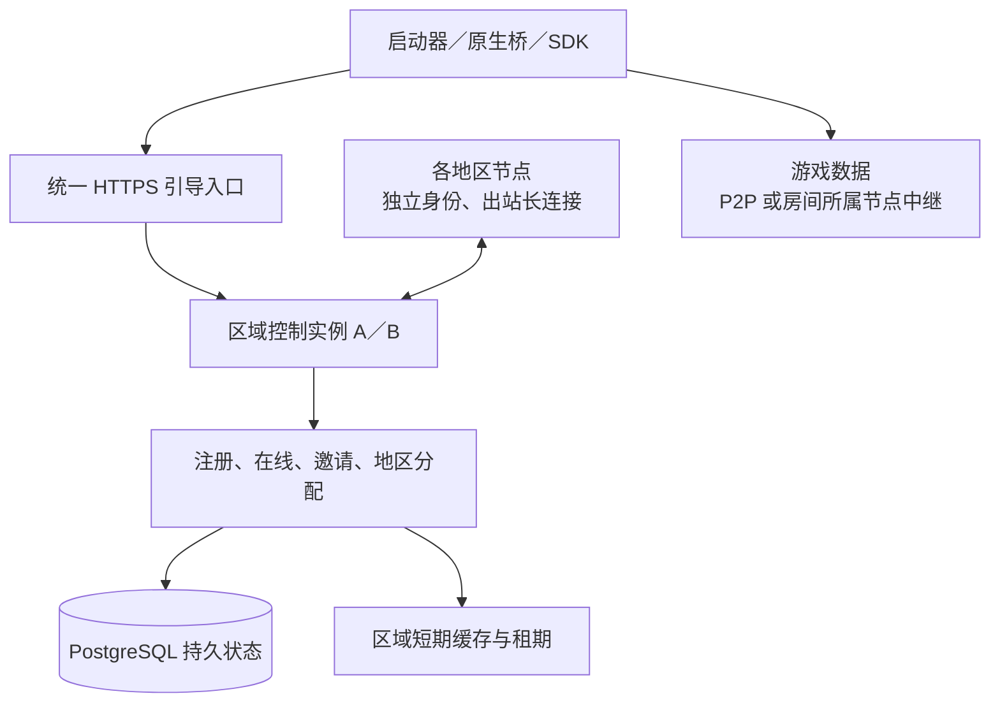

# 系统架构与边界

## 部署与职责

采用独立 C++20 控制服务，逻辑统一，实例可冗余；现有节点负责 SSH/WebRTC 入口和 C++ 数据转发。第三方仅安装节点，自动连接控制服务，不需要获得控制服务源码、管理员密钥或数据库。

同一个 HTTPS 地址可由负载均衡送到多个控制实例；实例之间不保留唯一的用户真相。节点通过出站 WSS/TLS 建立控制长连接，适应节点本机防火墙和 NAT；控制通道可连通不代表游戏入口可达，分配前单独验证 TCP/UDP 公网入口与运行期协议版本。

区分控制区域和数据区域。初期一个控制区域可管理多个数据区域；规模扩大后按控制区域分片，全球层只维护低频区域/身份路由摘要，不向所有节点复制所有在线与好友状态。不建立节点之间的全连接 Gossip 网。

## 技术栈决策

0.1 实际落地：C++20 + Asio/Beast + OpenSSL + simdjson/nlohmann + PostgreSQL；数据库在固定工作池中使用复用连接和超时，不在网络线程阻塞。以下非阻塞 libpq/区域缓存等仍是演进方向；当前没有 Redis、自研共识或消息代理。真实命令与限制见 08。

建议 C++20 + CMake，异步网络复用 Boost.Asio/Beast，TLS/签名/摘要复用 OpenSSL，JSON 优先评估 simdjson，持久状态用 PostgreSQL 的非阻塞连接池和事务。短期在线/节点快照按区域缓存；多实例共享租期优先评估 Redis 等成熟存储，但邀请/账号/撤销记录仍归 PostgreSQL，不能仅放缓存。

先实现一个可测纵向链路，再锁定版本及依赖清单；不自研 HTTP、TLS、数据库、密码算法、Raft 或消息代理。数据库 Outbox 可满足首版持久消息，规模证据出现后再评估专用消息系统。Asio 在不同系统适配原生异步机制，应用层不分别写 Windows/Linux 网络服务器。[Asio 官方实现说明](https://www.boost.org/doc/libs/latest/doc/html/boost_asio/overview/implementation.html)

PostgreSQL 的同步/异步复制存在延迟与故障数据损失的取舍；正式可用性目标必须绑定复制配置和切换演练，不能仅部署两个 API 进程就宣称高可用。[PostgreSQL 高可用说明](https://www.postgresql.org/docs/current/high-availability.html)

## 信任与独立私有服务

第三方节点仅获自身证书、配置、分配给它的会话和必要房间事件。它不能查询全网好友关系、签发任意玩家票据、复制其他账号密文，或用公共入网凭证管理其他节点。跨节点房间与好友路由由中心验证身份及授权；加入资格和管理员资格分离。

公开分发意味着注册入口对所有安装者可见；注册成功后为独立节点身份。节点先自动完成版本、入口可达性、证书持有和容量探测，再进入可分配池，不默认增加人工审批。自动探测证明可达和性能，不能证明运营者诚实；节点所有者、信任等级和是否允许社区节点必须是显式调度策略。官方/自有、已验证社区、普通社区可分池，默认池选择在上线配置确定并告知用户。

控制服务拟私有维护，协议与节点侧适配可公开。旧项目标注 AGPL，不能仅通过“新建目录”认定其源码可以直接闭源复制；独立协议通信、源码再利用及版权所有权授权分别核实。优先采用许可合适的第三方库和独立实现；自有代码需共享时登记授权来源。该边界需要结合真实代码和权利归属确认，不在规划中保证法律结论。[GNU 对程序组合边界的说明](https://www.gnu.org/licenses/gpl-faq.html#MereAggregation)

## 故障语义

中心故障不停止已经建立的数据转发；新注册、邀请和容量分配可暂时失败，界面真实显示降级。中心恢复后按事件游标补发。区域不可达不自动将所有用户跨区迁走；按 03 的节流和余量逐批恢复。房间节点故障不能无缝迁移现有 Minecraft TCP，应由桥重建并明确告知玩家。

正式部署建议至少两个控制实例、数据库主备及成熟的故障仲裁/隔离机制，避免双主；同步副本达不到持久化要求时停止确认写入。Redis 故障可以使在线状态 unknown、候选缓存重建，不丢失已确认的邀请。初期单机部署可用来开发，但不作为最终稳定性验收结论。
